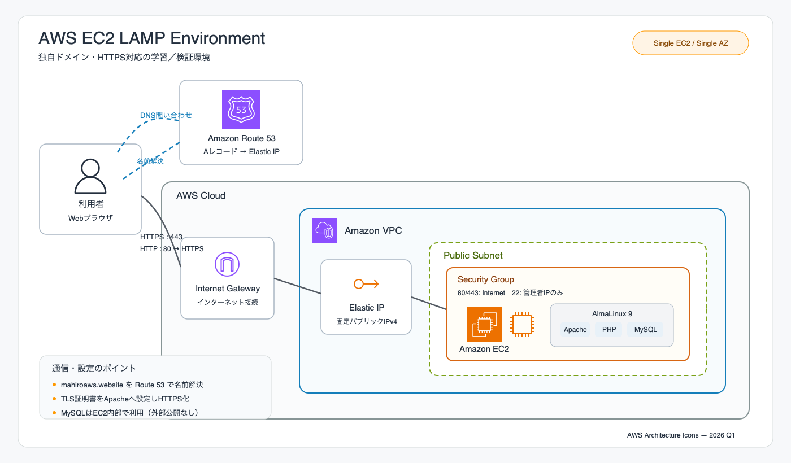

# AWS EC2 LAMP Environment

AWS EC2 上の AlmaLinux 9 に LAMP 環境を構築し、独自ドメインと HTTPS で Web ページを公開した学習プロジェクトです。

構築だけでなく、Apache の起動障害、403 Forbidden、HTTPS 接続エラーを切り分け、正常応答（HTTP 200）まで復旧した過程を記録しています。

## 目的

- EC2 を利用した Linux サーバー構築の基礎を身につける
- Apache、MySQL、PHP の導入と動作確認を行う
- Route 53 と独自ドメインを利用して Web サイトを公開する
- SSL/TLS を設定し、HTTPS 通信を実現する
- 障害発生時の確認順序と原因の特定方法を身につける

## 構成

利用者からRoute 53による名前解決、Internet Gateway、Elastic IP、Security Groupを経由して、Public Subnet内のEC2へ到達する通信経路を表しています。EC2上ではAlmaLinux 9、Apache、PHP、MySQLを稼働させています。

構成図には[AWS公式のArchitecture Icons](https://aws.amazon.com/architecture/icons/)を使用しています。

## 使用技術

| 分類 | 使用技術 |
|---|---|
| クラウド | AWS EC2、Amazon VPC、Route 53、Elastic IP |
| OS | AlmaLinux 9 |
| Webサーバー | Apache HTTP Server |
| データベース | MySQL |
| 実行環境 | PHP |
| ネットワーク | Security Group、HTTP/HTTPS、DNS |
| セキュリティ | SSL/TLS、HTTPS |

## 実施内容

1. VPC、サブネット、ルートテーブル、Internet Gatewayを設定
2. EC2インスタンスを作成し、Elastic IPを関連付け
3. Security GroupでSSH、HTTP、HTTPSの通信を制御
4. AlmaLinux 9へApache、MySQL、PHPを導入
5. ApacheのVirtualHostと公開ディレクトリを設定
6. Route 53で独自ドメイン `mahiroaws.website` のDNSレコードを設定
7. SSL/TLS証明書を設定し、HTTPSでのアクセスを確認
8. 発生したApache障害と接続エラーを調査・復旧

## 障害対応で確認したこと

Apacheが起動しない事象に対し、次の順番で切り分けました。

1. EC2インスタンスの稼働状態
2. Security Groupの許可ポート
3. `systemctl status httpd` によるサービス状態
4. `httpd -t` による設定ファイルの構文確認
5. ApacheのエラーログとSSL設定

原因は、`ssl.conf` が存在しない証明書ファイル `localhost.crt` を参照していたことでした。証明書の参照設定を見直した後、Apacheを再起動して復旧しました。

その後に発生した403 Forbiddenは公開ディレクトリとインデックスファイルを確認し、HTTPS接続エラーは443番ポートとSSL設定を確認しました。最終的にHTTPSでHTTP 200の応答を確認しています。

詳しい記録は以下にまとめています。

- [LAMP環境の構築手順](docs/build-guide.md)
- [障害対応記録](docs/troubleshooting.md)

## セキュリティ上の配慮

- SSHの接続元は自身のグローバルIPアドレスに制限
- HTTP/HTTPS以外の不要なポートは公開しない
- 秘密鍵、パスワード、AWSアカウントID、接続元IPはリポジトリに含めない
- 設定ファイルは実際の認証情報を除いたサンプルのみ掲載

## 学んだこと

- Webアクセス不可の原因は、AWS側とOS・ミドルウェア側の両方に存在する
- 「EC2 → Security Group → サービス状態 → 設定ファイル → ログ」の順に確認すると切り分けやすい
- Apacheは設定ファイル内の1つの参照エラーでも起動できなくなる
- DNS設定とHTTPS設定は、それぞれ名前解決・ポート・証明書を分けて確認する必要がある

## 今後の改善

- CloudFormationまたはTerraformによるIaC化
- Systems Manager Session Managerの利用によるSSH依存の削減
- Amazon RDSへのデータベース分離
- Application Load BalancerとAuto Scalingによる可用性向上
- CloudWatchによるログ収集と監視

## 注意事項

このリポジトリは学習内容を再構成したものです。AWSの認証情報、秘密鍵、パスワード、実IPアドレスなどの機密情報は掲載していません。

## 関連資格

- [AWS Certified Solutions Architect – Associate（Credly認証）](https://www.credly.com/badges/0962fe98-8a1d-456c-90c8-f58558412089/public_url)
